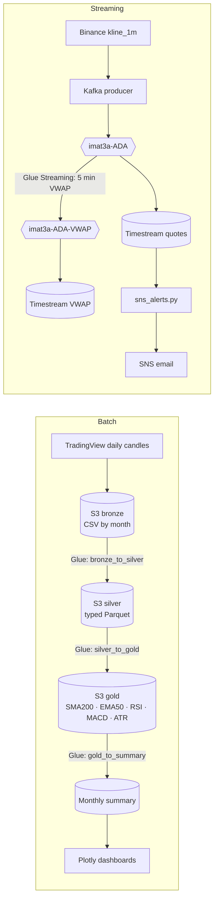

<div align="center">


# ADAQuant

A data platform for Cardano (ADA) on AWS: four years of daily prices in a bronze, silver and gold lake, technical indicators computed in Glue, and a live stream from Binance through Kafka to Timestream with email alerts.

**[Open the live demo](https://liiiaamm.github.io/adaquant/)** · [Architecture](#architecture) · [Run it](#running-it)


</div>

---

## What it does

ADAQuant has two lanes that end in the same place: indicators a trader can act on.

**Batch.** Daily ADA/USDT candles from 2022 to 2025 are downloaded, split by month and written to S3 as the bronze tier. Glue jobs clean and type them into silver, then compute SMA200, EMA50, RSI(14), MACD and ATR into gold, and roll each month up into a summary table (overbought and oversold days, golden and death crosses, volatility). The summary feeds the dashboards.

**Streaming.** A producer subscribes to Binance’s 1-minute ADA candles and publishes every closed candle to a Kafka topic. A Glue Streaming job computes a 5-minute VWAP over a sliding window and writes it to a second topic. Consumers land both topics in Amazon Timestream, and an alerting script reads Timestream, recomputes RSI, EMA50 and SMA200, and sends an SNS email on oversold, overbought, golden-cross or death-cross signals.

## The demo

The [demo page](https://liiiaamm.github.io/adaquant/) runs the streaming lane in your browser against Binance’s public market-data feed. It is the same logic, ported to JavaScript. Closed 1-minute candles appear as Kafka messages in the producer’s exact format. The VWAP window matches the Glue Streaming job, and the four alert rules come from `sns_alerts.py`, using the same Wilder RSI and seeded EMA. Below it, the batch lane plots the real gold summary from `market_analysis/gold_ada.csv`, 48 months of it.

## Architecture



## Repository map

| Path | What is inside |
|------|----------------|
| `load_data/` | TradingView downloader, monthly partitioning, S3 bucket layout and uploader (`AdaquantLoadPipe`) |
| `scripts/` | `run_ingestation_pipeline.py` (CLI for the batch load) and `pipeline_status.py`, which writes `PIPELINE_STATUS.md` from S3 |
| `glue/` | Glue database and crawler setup |
| `jobs_aws/` | Glue jobs: bronze → silver, silver → gold, gold → summary, and the streaming VWAP job |
| `kafka/` | Binance producer, raw and VWAP consumers, SNS alerts, and a [Kafka cheat sheet](kafka/README.md) |
| `timestamp/` | Kafka → Timestream consumers and a direct Timestream write test |
| `market_analysis/` | Dashboard scripts and the exported gold and summary tables |
| `tests/` | Manual smoke tests for the load pipe, the Glue crawler and Spark reads |
| `docs/` | Sprint reports (Spanish) |
| `brand_visuals/` | Logo, banner and palette |

## Running it

Everything that touches AWS needs your own account. Copy `.env.example` to `.env`, fill in the bucket, Kafka broker and Glue role, then:

```bash
python3 -m venv .venv && source .venv/bin/activate
pip install -r requirements.txt
set -a; source .env; set +a
```

**Batch lane**

```bash
bash bash/run_ingestion_pipeline.sh run --verbose-pipeline   # download, build bronze/silver/gold prefixes, upload
python3 tests/test_glue.py                                    # crawler over bronze
python3 scripts/pipeline_status.py                            # refresh PIPELINE_STATUS.md
aws glue start-job-run --job-name <bronze_to_silver | silver_to_gold | gold_to_summary>
cd market_analysis && python3 dashboard_ada.py && python3 dashboard_summary_ada.py
```

The Glue jobs import `awsglue`, so they run inside Glue, not locally. The streaming job takes its broker and credentials as job parameters: `--KAFKA_BOOTSTRAP_SERVERS`, `--KAFKA_USERNAME` and `--KAFKA_PASSWORD`.

**Streaming lane**, one terminal each:

```bash
python3 kafka/binance_kafka_consumer.py        # raw topic
python3 kafka/binance_kafka_producer.py        # Binance → imat3a-ADA
python3 kafka/binance_kafka_consumer_vwap.py   # needs the Glue Streaming job running
python3 timestamp/timestream_consumer.py       # quotes → Timestream
python3 kafka/sns_alerts.py                    # indicators from Timestream → SNS email
```

## Known gaps

- There is no infrastructure as code. S3, Glue, the EC2 Kafka broker, Timestream and SNS were created by hand.
- The files in `tests/` are smoke scripts, not a pytest suite.
- `load_data/eda_crypto.py` predates the current `CryptoDataLoader` signature.

## Team

Built in spring 2026 for Big Data Processing Technologies (BSc in Mathematical Engineering and AI, Comillas ICAI) by **Sergio Fernández Cordero** ([@SergioFdz05](https://github.com/SergioFdz05)), **Alejandro Alcázar Mendoza** and **Liam Esgueva** ([@liiiaamm](https://github.com/liiiaamm)).
